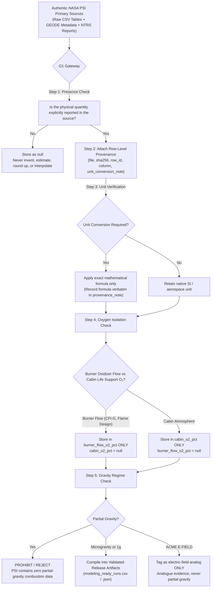

# PYRO-ASTRA Dataset Card: NASA PSI Microgravity Fire Safety Data Release

**Version:** 2.0.0  
**Release Date:** November 2026  
**Challenge:** NASA Space Apps Challenge 2026 — *Flame in Freefall*  
**Platform:** PYRO-ASTRA Spacecraft Fire Safety Intelligence Dashboard  
**Curators:** PYRO-ASTRA Science & Data Engineering Swarm (A2 DATA-WIRE)  

---

## 1. Executive Summary & Open Data License

The **PYRO-ASTRA Microgravity Fire Safety Dataset** is a curated, scientifically grounded, and fully provenanced dataset derived from NASA's **Physical Sciences Informatics (PSI)** system and official NASA Technical Reports. It structures experimental findings across **18 NASA combustion investigations** and compiles **1,815 modeling-ready experimental runs** conducted in microgravity aboard the International Space Station (ISS), the Space Shuttle, and the uncrewed Cygnus resupply spacecraft.

The dataset addresses fire safety in pressurized human crew environments—space stations, transit vehicles, lunar bases, and Martian rovers—spanning the three core safety areas: **Fire Prevention**, **Fire Detection**, and **Fire Suppression**.

### Open Data License Statement
> **"There are no restrictions on the use of this data."**  
> — *Registry of Open Data on AWS: NASA Physical Sciences Informatics (PSI)*  
> Official Registry URI: [https://registry.opendata.aws/nasa-psi/](https://registry.opendata.aws/nasa-psi/)

All underlying experimental data, technical memorandum tables, and metadata files originate from the United States Government (NASA) and are dedicated to the public domain under **Creative Commons Zero v1.0 Universal (CC0-1.0)**. The PYRO-ASTRA data schemas, parsing tools, and web interface are licensed under the **MIT License** (see `release/LICENSE.txt`).

---

## 2. Non-Negotiable Grounding Rules (Rule G1 Specification)

All artifacts in this release adhere strictly to the foundational scientific rules defined in Section 2 of `SPEC.md` and Human Gate 1 directives:



### The 5 Core G1 Mandates:
1. **Strict Null Policy (Never Guess):** Never invent, estimate, round up, or interpolate a value. If PSI does not state it, store `null` and show 'not reported'.
2. **Mandatory Provenance on Every Row:** Every single row carries an authentic provenance block: `{file, sha256, row id, column, unit_conversion_note}`.
3. **Exact Mathematical Unit Conversions:** Conversions are permitted ONLY with exact mathematical formulas stated in headers and provenance notes:
   - $1\text{ atm} = \frac{101325}{6894.757}\text{ psi} \approx 14.6959488\text{ psi}$
   - $1\text{ mmHg} = \frac{14.6959488}{760}\text{ psi} \approx 0.01933677\text{ psi}$
   - $1\text{ bar} = \frac{100000}{6894.757}\text{ psi} \approx 14.5037738\text{ psi}$
   - $1.0\text{ mole fraction } \text{O}_2 = 100.0\%\text{ vol}$
4. **Strict Isolation of Burner Oxygen:** Oxygen in burner feed lines (such as ACME CFI-G up to 85% $\text{O}_2$, Flame Design up to 85% oxidizer) is strictly isolated into `burner_flow_o2_pct`. `cabin_o2_pct` is strictly `null` for burner flames to prevent life-support atmosphere conflation.
5. **Zero Partial-Gravity Extrapolation:** NASA PSI combustion data contains zero lunar ($0.16g$) or Martian ($0.38g$) measurements. Gravity is strictly reported as `microgravity`, `1g` (ground companion test), or `electric-field-analog` (ACME E-FIELD Flames).

---

## 3. Dataset Architecture: Two Complementary Levels

The release provides two complementary tiers of microgravity combustion data:

1. **Investigation-Level Catalog (`investigations.csv` & `extractions.json`):**
   - Covers all **18 NASA PSI investigations** (8 metadata mined deep records + 10 experimental table ingested catalog records).
   - Features 88 columns detailing hardware, research objectives, fuel matrices, condition envelopes, sensors, DOIs, and verbatim grounded quotes with JSON key paths.
2. **Run-Level Modeling Dataset (`modeling_ready_runs.csv` & `modeling_ready_runs.json`):**
   - Compiles **1,815 discrete table rows** (1,807 discrete test runs + 8 candidate sets).
   - 44 standardized columns optimized for machine learning surrogate modeling, grouped cross-validation, and flame spread analytics.
   - 100% row-level provenance with authentic SHA-256 digests.

---

## 4. Run-Level Experimental Table Inventory (1,815 Table Rows)

| PSI ID | Acronym | Fuel Phase | Authentic Primary Source File | File SHA-256 (64-char Hex) | Table Runs | Suspect Runs | Key Physical Measurements |
|---|---|---|---|---|---|---|---|
| **PSI-25** | BASS-II | Solid | `raw_real/PSI-25/experimental_table/PSI-25_Experimental_table_BASS-II.csv` (Table 5.1 merged) | `db4f5fcc2416fd2150e58c2d73d761090106271a640ecd189297eb7c3cf2951f` | 129 | 2 | Solid flammability matrix (films, rods, slabs, Nomex, SIBAL); initial $\text{O}_2$ ($13.6\text{--}22.2\%$), $\text{CO}$, $\text{CO}_2$; Table 5.1 spread rates merged on M1–M20. |
| **PSI-26** | BASS | Solid | `raw_real/PSI-26/experimental_table/PSI-26_Experimental table_BASS.csv` | `ccfc3c54d948b64a1c5d2596a63c7c8019e51df0c91a1d62f039f48fa28c300f` | 122 | 0 | Solid polymer and fabric extinction tests in MSG flow duct (SIBAL, PMMA, Cotton/Fiberglass). |
| **PSI-98** | SAFFIRE-I | Solid | `raw_real/PSI-98/experimental_table/PSI-98_Experimental table_SAFFIRE-1.csv` | `c01f29c62455f0a3b512290ab85e5687ecded326733189f002f580368402308d` | 4 | 0 | Large-scale SIBAL fabric burn aboard Cygnus; airflow $20.0\text{ cm/s}$, ignition power $182.0\text{ W}$, burn time $70\text{--}420\text{ s}$. |
| **PSI-99** | SAFFIRE-II | Solid | `raw_real/PSI-99/experimental_table/PSI-99_Experimental table_SAFFIRE-2.csv` | `3c24390b9ef86f3d1ebaab911a1a3cc95a8759aebf42062371370e6d4b31b8ac` | 15 | 0 | Multi-sample card burns (Silicone, SIBAL, PMMA, Nomex); airflow $20.0\text{--}30.0\text{ cm/s}$, ignition $80.0\text{ W}$. |
| **PSI-100** | SAFFIRE-III | Solid | `raw_real/PSI-100/experimental_table/PSI-100_Experimental table_SAFFIRE-3.csv` | `4d3c717ec20dd0247db670b2784a9fd7d746788bc54a936f80693e48eb8cd117` | 2 | 0 | SIBAL fabric large-scale burns aboard Cygnus; airflow $30\text{ cm/s}$. |
| **PSI-68** | FLEX-2 | Liquid Droplet | `raw_real/PSI-68/experimental_table/PSI-68_Experimental table_Flex2.csv` | `cc57ad1bd9977aa13e7ac6c3aa618303012686e232b36c052c6a9f1a74e5f528` | 8 | 0 | Binary alkane droplets (heptane/hexadecane); temp $25.0^\circ\text{C}$, candidate sets reach $30\%\text{ O}_2$ and $0.5\text{ atm}$ ($7.35\text{ psi}$). |
| **PSI-69** | FLEX | Liquid Droplet | `raw_real/PSI-69/experimental_table/PSI-69_Experimental table_FLEX.csv` | `37c88ce8ae9391b7544ff630a45ce87543d04d317cdbfbed104fe7d5c27e1b96` | 274 | 0 | Droplet extinction dynamics, $0.5\text{--}3.0\text{ atm}$ ($7.35\text{--}44.86\text{ psi}$), $12\%\text{--}34\%\text{ O}_2$, extinction diameter, burning rate. |
| **PSI-39** | CFI | Liquid Droplet | `raw_real/PSI-39/experimental_table/PSI-39_Experimental table_CFI.csv` | `fb898e28762353aa132c16b886dbd207a024b1dd3c9bed5928d70d8036d2ec7e` | 87 | 0 | Isolated droplet combustion in MDCA chamber (n-Dodecane, n-Heptane); ambient pressure and inert dilution. |
| **PSI-10** | Flame Design | Gas | `raw_real/PSI-10/experimental_table/PSI-10_Experimental table_Flame Design_Normal Flame (1).csv` | `4a663292bd3f65201943cc71bd661a70383639276a9176f64105b285bf0b6deb` | 327 | 0 | Ethylene gas diffusion flames (207 Normal + 120 Inverse); oxidizer stream $\text{O}_2$ ($17\text{--}85\%$), $P = 14.67\text{--}17.00\text{ psi}$, $T_{ad} = 1856\text{--}2649\text{ K}$. |
| **PSI-20** | ACME-BRE | Gas | `raw_real/PSI-20/experimental_table/PSI-20_Experimental table_ACME BRE.csv` | `4aa5d3f98708ceacced5c620d46858b9965f8d4d941b203229f46467d53e5ab7` | 18 | 0 | Burning Rate Emulator gas burner ($25.0\text{ mm}$); Ethylene, chamber $\text{O}_2$ ($21\text{--}40\%$). Pressure not reported (`null`). |
| **PSI-22** | ACME E-FIELD | Gas (Analog) | `raw_real/PSI-22/experimental_table/PSI-22_Experimental table_ACME E-FIELD Flames.csv` | `69090c357b83ae38d161d29001d1d32b40fd77b13324ca6585ee990cdceef524` | 32 | 0 | High-voltage electric field analog on gas flames. Strictly tagged `electric-field-analog`, NEVER partial-gravity. |
| **PSI-23** | ACME s-Flame | Gas | `raw_real/PSI-23/experimental_table/PSI-23_Experimental table_ACME s-Flame.csv` | `16cd10f50bd2e962887c8eb4077e5a9b3e790c78de8e0361c0b77e19300be7cf` | 18 | 0 | Spherical gas diffusion flames; Ethylene and Methane dilution with $\text{N}_2$. Pressure not reported (`null`). |
| **PSI-106** | SLICE | Gas | `raw_real/PSI-106/experimental_table/PSI-106_Experimental table_Slice.csv` | `89ef980810ca6d9aa8be817b42e36cd2adff23f5e9058361b5a33d18b4363f4d` | 12 | 0 | Gaseous flame liftoff and extinction limits in MSG (Methane, Ethylene, Ethane). |
| **PSI-107** | Spice | Gas | `raw_real/PSI-107/experimental_table/PSI-107_Experimental table_Spice.csv` | `fb0d7e60cf5367afb429089e9901d27288f78038efd26c8de1db4fbe04117136` | 469 | 8 | Smoke point coflow diffusion flames in CIR; physical positive airflow envelope $0.66\text{--}85.28\text{ cm/s}$ ($n=436$). |
| **PSI-159** | CFI-G | Gas | `raw_real/PSI-159/experimental_table/PSI-159_Experimental table_CFI-G_Normal Flames (1).csv` | `d95a621c3fbd27d204dd32ed29fa17d68f2b779d6a523cde8479ed7ebaa5251a` | 179 | 0 | Gas burner coflow flames (ethane, propane, butane); burner feed $\text{O}_2$ up to $85\%$, $P = 7.35\text{--}44.09\text{ psi}$, $T_{ad}$ up to $2730\text{ K}$. |
| **PSI-101** | SAME-R | Smoke | `raw_real/PSI-101/experimental_table/PSI-101_Experimental table_SAME-R.csv` | `87164b7dc9168a4273c159f7a9f23699afbd06ad97b77974377e79b9bf8a3bef` | 109 | 0 | Pyrolysis particulate aging in MSG (Kapton 29, Silicone 22, Lampwick 20, Pyrell 20, Teflon 18; Test 57 dup); velocity $1.4\text{--}8.1\text{ cm/s}$. |
| **PSI-102** | SAME | Smoke | `raw_real/PSI-102/experimental_table/PSI-102_Experimental table_SAME.csv` | `268d1e121d2f211b124407dd32b9475617bd269ede2c2d1749441da3e949a2af` | 8 | 0 | Smoke particulate generation; airflow $5.0\text{ cm/s}$, pyrolysis weight loss rate $0.7\text{--}3.2\text{ mg/min}$. |
| **PSI-47** | DAFT | Dust | `raw_real/PSI-47/experimental_table/PSI-47_Experimental table_DAFT.csv` | `d9d1a436c6e7bbc410b433e04575fe7dedaff763b5237d688089929b7393b5c0` | 2 | 0 | Dust aerosol stability in microgravity (Arizona Road Dust); categorized as distinct 'dust' phase. |
| **TOTAL** | — | — | **17 Ingested Experimental Flight Tables** | — | **1,815** | **10** | **Complete Deduplicated Microgravity Fire Safety Corpus** |

---

### 4.1 Run Totals & Fuel Phase Reconciliation Ledger

To ensure absolute mathematical consistency between raw extraction scripts, intermediate tables, and final release artifacts, the following reconciliation ledger is documented:

1. **Deduplication of Table 5.1 & Total Corpus Accounting (1,815 Table Rows)**:
   - Tests M1–M20 published in Table 5.1 of NASA/TM-20210011385 (p. 57) represent the identical physical flight burns as tests M1–M20 in the primary BASS-II experimental table (`PSI-25_Experimental_table_BASS-II.csv`). Rather than creating 20 duplicate row entries, the Table 5.1 flow velocity, flame spread rate, and sample dimensions are merged directly onto those existing BASS-II rows.
   - BASS-II comprises exactly **129 table rows**.
   - Bibliographic figure index table PSI-142 (8 figure index rows linking literature curves) is excluded from run-level test datasets.
   - **Run vs Candidate Set Accounting**: The dataset comprises **1,807 discrete test runs + 8 candidate sets = 1,815 table rows**. FLEX-2 (PSI-68) lists 8 candidate condition sets ({17,21,25,30}% O₂ at {0.5,1,1.5,2,3} atm) outlining planned condition permutations rather than confirmed individual runs.

2. **Fuel Phase Breakdown**:
   - **Liquid Droplets (369 table rows)**: FLEX (274 runs, PSI-69) + CFI (87 runs, PSI-39) + FLEX-2 (8 candidate sets, PSI-68).
   - **Solid Flame Spread (272 table rows)**: BASS-II (129), BASS (122), SAFFIRE-I (4), SAFFIRE-II (15), SAFFIRE-III (2).
   - **Gaseous Burner Flames (1,055 table rows)**: CFI-G (179), Flame Design (327), ACME-BRE (18), ACME E-FIELD (32), ACME s-Flame (18), SLICE (12), SPICE (469).
   - **Pyrolysis Smoke Products (117 table rows)**: SAME-R (109), SAME (8).
   - **Particulate Dust (2 table rows)**: DAFT (2).

3. **Per-Table Breakdown of Rows Reporting Both O₂ and Pressure (640 Table Rows Total)**:
   - **Cabin Atmosphere (274 rows reporting both)**:
     - FLEX (PSI-69): 274 rows report both (12–34% O₂, 7.35–44.86 psi; all O₂ ≥ 30% are at pressure ≥ 10.33 psi; 0 rows combine both O₂ ≥ 30% and P ≤ 10.2 psi).
     - FLEX-2 (PSI-68): 8 candidate sets (pressure null in table).
     - CFI (PSI-39): 87 droplet runs (pressure not reported in table).
     - Solid (BASS-II 129, BASS 122, SAFFIRE-I 4, SAFFIRE-II 15, SAFFIRE-III 2), Smoke (SAME-R 109, SAME 8), Dust (DAFT 2): pressure not reported (`null`).
   - **Oxidizer / Burner Feed Streams (366 rows reporting both; isolated per Rule 4, NOT Cabin Air)**:
     - CFI-G (PSI-159): 179 rows report both burner O₂ and pressure (20 rows at 7.35 psi with burner O₂ 35.85–39.26%).
     - Flame Design (PSI-10): 187 rows report both oxidizer O₂ and pressure (18 Inverse Flame rows at 6.26–7.57 psi with oxidizer O₂ 31.97–85%).
     - ACME-BRE (18), ACME s-Flame (18), SLICE (12), SPICE (469): pressure not reported (`null`).
   - **Lunar Exploration Target Overlap**: Across all 274 cabin atmosphere rows reporting both, exactly **zero table rows** combine O₂ ≥ 30% and pressure ≤ 10.2 psi.

4. **SAME-R Accounting (109 Table Rows)**:
   - The authentic raw table (`PSI-101_Experimental table_SAME-R.csv`, SHA-256: `87164b7dc9168a4273c159f7a9f23699afbd06ad97b77974377e79b9bf8a3bef`) contains exactly **109 table rows** with non-empty `SAME Test #` entries.
   - Material breakdown: Kapton (29), Silicone (22), Lampwick (20), Pyrell (20), Teflon (18) = 109 rows total. Test 57 was executed on both Row 56 (Lampwick) and Row 74 (Teflon). Both Q02 and Q11 evaluate to `Not assessable` for SAME-R because neither Nomex nor mist was tested, and oxygen and pressure were not reported.

5. **Uniform Fuel-Phase Taxonomy**:
   - Both SAME (PSI-102) and SAME-R (PSI-101) strictly use the uniform fuel-phase label `'smoke'` across all schemas (`data/schema.ts`), catalogs (`data/investigations.json`), modeling tables (`release/modeling_ready_runs.csv` / `.json`), and dictionaries (`release/field_dictionary.json`).

---

## 5. Suspect Row Ledger (10 Documented Rows)

In strict accordance with data transparency, anomalous raw data points are explicitly flagged with `is_suspect = True` and preserved verbatim rather than secretly purged:

1. **BASS-II Final Oxygen Anomalies (2 Rows in PSI-25):**
   - `PSI-25_P22b` (Line 72) and `PSI-25_T28b` (Line 126).
   - **Reason:** Calibrated post-test final $\text{O}_2$ exceeds initial $\text{O}_2$ by $> 1.0\%$ due to Glovebox chamber sensor calibration drift during repressurization.
2. **Spice Negative Airflow Measurements (8 Rows in PSI-107):**
   - `PSI-107-ROW-295`, `297`, `298`, `299`, `300` ($-0.28\text{ cm/s}$) and `PSI-107-ROW-336`, `337`, `338` ($-5.92\text{ cm/s}$).
   - **Reason:** Negative flow values recorded due to CIR flow meter reverse transducer drift under quiescent flame transitions.
   - **Action:** Flagged suspect and excluded from the physical convective airflow envelope ($0.66\text{--}85.28\text{ cm/s}$, $n=436$).

---

## 6. Guidance for Machine Learning & Surrogate Modeling

Researchers utilizing `release/modeling_ready_runs.csv` or `modeling_ready_runs.json` must follow the preregistered modeling protocols:

1. **Grouped Cross-Validation Required:**
   - Always group by `group_condition` or `investigation_id` (e.g. Leave-One-Condition-Out or Leave-One-Fuel-Out CV).
   - Standard random train/test splits overestimate performance due to correlation across repeated runs of identical fuel/atmosphere combinations.
   - For droplet models, analyze physical measurements only ($n = 189$, excluding 8 complete-combustion zero rows). Report MAE with 95% bootstrap confidence intervals (p-values omitted).
2. **Fuel Phase Segregation & Per-Fuel Applicability Domains:**
   - Never pool models across fuel phases (e.g. predicting solid polymer flame spread using liquid droplet burning rates).
   - Evaluate applicability domains independently per fuel (Methanol vs Heptane). The 1.50 normalized distance threshold is an established engineering convention.
3. **Strict Lunar / Partial-Gravity Abstention & Extrapolation Findings:**
   - Models must strictly refuse predictions for Lunar exploration conditions ($34\%\text{ O}_2$, $8.2\text{ psi}$) and partial gravity ($0.16g$, $0.38g$).
   - The dataset contains zero empirical data in these regimes. Any prediction would constitute ungrounded extrapolation outside the applicability domain.
   - **Preregistered Null Result Finding:** *"On the FLEX droplet data, error rose by 211.3% when the highest-pressure or highest-O2 conditions were held out; the lunar habitat point is outside every measured range and is refused."* (Linear Regression MAE rose from 0.4320 mm to 1.3450 mm [+211.3%]; Polynomial Regression rose from 0.4300 mm to 1.8491 mm [+330.0%]; Random Forest rose from 0.3622 mm to 0.5487 mm [+51.5%]).
   - **Model Nature:** The surrogate is strictly a **demonstrator on liquid droplets**, NOT a habitat safety predictor.

---

## 7. Release Artifact Inventory & Checksums

| Artifact | Format | Description | Static Download Path |
|---|---|---|---|
| `modeling_ready_runs.csv` | CSV | 1,815 experimental test runs with 44 standardized columns and row-level provenance | `/release/modeling_ready_runs.csv` |
| `modeling_ready_runs.json` | JSON | Machine-readable JSON array of 1,815 runs with rules metadata and schema definitions | `/release/modeling_ready_runs.json` |
| `investigations.csv` | CSV | Flat tabular export of all 18 NASA PSI investigations with column-level provenance | `/release/investigations.csv` |
| `extractions.json` | JSON | Grounded physical condition extractions featuring verbatim quotes and JSON key paths | `/release/extractions.json` |
| `table_5_1_bass2.csv` | CSV | Hand-verified flight burn test matrix of 20 tests from NASA/TM-20210011385 Table 5.1 | `/release/table_5_1_bass2.csv` |
| `table_5_1.csv` | CSV | Standardized alias for BASS-II Table 5.1 flight test matrix (20 tests) | `/release/table_5_1.csv` |
| `availability.json` | JSON | Machine-readable catalog indexing GEODE endpoints and S3 URI paths | `/release/availability.json` |
| `field_dictionary.json` | JSON | Exhaustive schema dictionary of 69 fields (25 investigation + 44 run fields) | `/release/field_dictionary.json` |
| `DATASET_CARD.md` | Markdown | Formal scientific dataset card documenting scope, sources, G1 rules, and gaps | `/release/DATASET_CARD.md` |
| `manifest.sha256` | Text | SHA-256 checksums of every release artifact for tamper-evident verification | `/release/manifest.sha256` |
| `manifest.json` | JSON | Release manifest with byte sizes, descriptions, format indicators, and checksums | `/release/manifest.json` |
| `LICENSE.txt` | Text | Full licensing terms (AWS Open Data statement, NASA CC0-1.0, and MIT) | `/release/LICENSE.txt` |

---

## 8. Ingestion & Analysis Quickstart

### Python (Pandas) Quickstart
```python
import pandas as pd
import json

# 1. Load modeling-ready runs (1,815 test runs)
runs_df = pd.read_csv("https://pyro-astra.vercel.app/release/modeling_ready_runs.csv")
print(f"Loaded {len(runs_df)} experimental runs across {len(runs_df.columns)} columns.")

# Filter non-suspect microgravity solid fuel runs with measured flame spread rates
solid_spread_df = runs_df[
    (runs_df["fuel_phase"] == "solid") &
    (runs_df["gravity_regime"] == "microgravity") &
    (~runs_df["is_suspect"]) &
    (runs_df["flame_spread_rate_mm_s"].notna())
][["run_id", "test_id", "fuel_raw", "airflow_speed_cm_s", "cabin_o2_pct", "flame_spread_rate_mm_s", "provenance_file_sha256"]]
print(solid_spread_df)

# 2. Check row-level provenance on every single row
missing_prov = runs_df[runs_df["provenance_file_sha256"].isna()]
assert len(missing_prov) == 0, "Rule G1 violation: row missing provenance!"
print("Provenance check: 100% of rows carry valid SHA-256 hash digest provenance.")
```

### Verification via cURL & SHA-256
```bash
# Download checksum manifest and dataset
curl -O https://pyro-astra.vercel.app/release/manifest.sha256
curl -O https://pyro-astra.vercel.app/release/modeling_ready_runs.csv

# Verify SHA-256 integrity
sha256sum -c manifest.sha256 --ignore-missing
```

---

## 8. Known Gaps and Physical Boundaries

1. **Zero Partial-Gravity Data in NASA PSI**:
   - NASA Physical Sciences Informatics (PSI) currently contains zero combustion data for partial-gravity regimes, including the Moon ($0.16g$) and Mars ($0.38g$).
   - All empirical test runs are strictly microgravity ($\mu g$) or 1g companion ground tests.
   - ACME E-FIELD Flames (PSI-22) utilizes an electric field to mimic buoyant ion drift; this is strictly tagged as `electric-field-analog` and must never be cited or modeled as partial gravity.
   - Future exploration missions (e.g. LUCI on the lunar surface and FM2 on commercial lunar payload flights) are planned to collect the first in-situ lunar combustion data.

2. **Absence of Lunar Habitat Exploration Atmosphere Flight Tests**:
   - Across all 17 ingested experimental flight tables and 1,815 test runs, exactly **zero flight tests** combine elevated oxygen ($\ge 30\%\text{ O}_2$) and reduced exploration chamber pressure ($\le 10.2\text{ psi}$) in cabin air.
   - While Flame Design (PSI-10) and CFI-G (PSI-159) feature elevated oxygen, those are burner nozzle oxidizer feeds, not crew cabin environments.
   - Any statistical or machine learning estimation in the NASA Lunar Exploration Atmosphere ($34\%\text{ O}_2$, $8.2\text{ psi}$) represents severe ungrounded extrapolation and is strictly prohibited under Rule G5.

3. **Unmeasured In-Flight Parameters**:
   - Flight hardware constraints left parameters unmeasured in several investigations: e.g. chamber pressure in BASS-II (the MSG Glovebox lacked automated pressure telemetry in the flight test matrix), oxygen concentration in SAME/SAME-R pyrolysis runs, and sample dimensions in certain gas burner configurations.
   - In accordance with Rule G1, these missing values are strictly recorded as `null` and displayed as 'not reported', never interpolated or imputed.

---

## 9. What is NOT Included and Why

1. **Rockets, Thrusters, and Liquid Propellants**:
   - **Why Excluded:** The NASA Space Apps Challenge brief focuses on spacecraft cabin and habitat fire safety. Rocket engines, toxic hypergolic propellants, and solid rocket motors operate under external hypersonic or combustion chamber regimes outside crew cabin safety.
2. **Ungrounded Partial-Gravity Predictions**:
   - **Why Excluded:** Per Rule 5, the project refuses to generate ungrounded partial-gravity predictions. No reliable empirical basis exists in microgravity flight data to extrapolate flame behavior to lunar or martian gravity without in-situ flight validation.
3. **Model Estimates Stored as Experimental Ground Truth**:
   - **Why Excluded:** Per Rule 7 and Rule 20, model estimates are never stored in the tabular datasets (`modeling_ready_runs.csv` / `.json`), never cited as PSI empirical observations, and always render with transparent uncertainty and disclaimer bounds.
4. **Live Web Scraping of NASA PSI**:
   - **Why Excluded:** Live web scraping creates fragile, non-reproducible runtime dependencies and risks querying unverified transient endpoints. All raw data files are curated into authentic repositories with immutable SHA-256 hashes.
5. **Invented, Rounded, or Interpolated Values**:
   - **Why Excluded:** Per Rule 1 (Section 2), if NASA PSI does not report a quantity, the dataset records `null`. Imputing values under microgravity conditions creates false safety assurance that could jeopardize astronaut life support systems.

---

## 10. Citation & Attribution

```bibtex
@misc{pyro_astra_modeling_runs_2026,
  title        = {PYRO-ASTRA: Modeling-Ready Microgravity Combustion Test Runs Dataset and Provenance Ledger},
  author       = {{PYRO-ASTRA Team}},
  year         = {2026},
  howpublished = {\url{https://registry.opendata.aws/nasa-psi/}},
  note         = {NASA Space Apps Challenge 2026, 'Flame in Freefall'}
}
```
