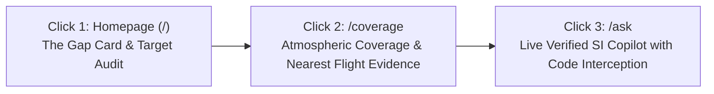

# PYRO-ASTRA: NASA Space Apps 2026 Judge Guide & 60-Second Tour

**NASA Space Apps Challenge 2026**  
**Challenge:** *Flame in Freefall: SI-Powered Fire Safety Insights from Microgravity Combustion Data*  
**Global Submission Deadline:** November 15, 2026 at 11:59 PM Local Time (per participant's registered local event timezone; registration closes November 15, 2026 at 11:59 PM Local Time).  

---

## 1. Executive Summary for Judges

Welcome, NASA Space Apps Judges! **PYRO-ASTRA** is a research-grade spacecraft fire safety intelligence dashboard built to **summarize**, **rank**, and **interpret** four decades of microgravity combustion data from NASA's Physical Sciences Informatics (PSI) system.

In closed space habitats, fire is an existential threat. Yet public archives in NASA PSI contain **zero combustion datasets collected in lunar ($0.16g$) or Martian ($0.38g$) gravity**. Rather than masking data scarcity with ungrounded interpolations or black-box predictions, PYRO-ASTRA enforces radical scientific honesty: **Evidence you can trace, gaps you can see**.

---

## 2. Alignment with Official Judging Criteria

| Judging Criterion | Focus Area | How PYRO-ASTRA Demonstrates Excellence | Where to Verify in App |
|---|---|---|---|
| **1. Impact** | Real-world problem & meaningful value | Clarifies environmental boundaries for planned exploration habitats (e.g. Moon base at $34\%\text{ O}_2$, $8.2\text{ psi}$); pinpoints untested safety regimes for mission planners and ECLSS engineers. | [`/`](file:///), [`/coverage`](file:///coverage), [`/path`](file:///path) |
| **2. Creativity** | Originality & innovative approach | Turns data scarcity into a primary discovery feature: exposes the partial-gravity gap, provides physics-grounded bounding ($0g$ vs $1g$), and pairs a live SI copilot with hard programmatic verifier guardrails. | [`/`](file:///), [`/ask`](file:///ask), [`/surprises`](file:///surprises) |
| **3. Validity** | Scientific foundation & accuracy | 100% provenance on every number (`<Val>` component refuses unprovenanced values); nulls over guesses; verified unit conversions; strict refusal of partial-g predictions and rocket queries. | [`/trust`](file:///trust), [`/data-quality`](file:///data-quality) |
| **4. Relevance** | Directly addresses challenge & open data | Fulfills all 4 challenge objectives (Summarize, Rank, Interpret, Deliver Insights); mines 18 NASA investigations, 129 BASS-II table rows, 274 FLEX rows, 109 SAME-R rows, and NASA technical reports. | [`/rank`](file:///rank), [`/compare`](file:///compare), [`/data`](file:///data) |
| **5. Presentation** | Storytelling, clarity & accessibility | High-contrast mission-control UI, responsive phone layout, interactive WebGL/SVG flame HUD, light/dark themes, and a 60-second 3-click evaluation pathway. | [`/`](file:///), [`/coverage`](file:///coverage), [`/readiness`](file:///readiness) |

---

## 3. The 60-Second Judge Tour (3 Clicks)

Experience the core scientific breakthroughs of PYRO-ASTRA in 60 seconds:



### Click 1: The Gap Card & Exploration Atmosphere Audit
* **Route:** [`/`](file:///)
* **Action:** Scroll down immediately beneath the *Hero Flame Physics HUD* to the card titled **"Critical Finding: The Partial-Gravity Data Gap"**.
* **What You See:**
  - An empirical disclosure that NASA Physical Sciences Informatics (PSI) contains exactly **0** combustion datasets recorded in lunar ($0.16g$) or Martian ($0.38g$) surface gravity.
  - The deterministic **Moon-Base Target Criteria Audit Table** ($O_2 \ge 30\%$, $\text{Pressure} \le 10.2\text{ psi}$):
    * **Headline:** *"676 rows report both (369 cabin rows); none are >=30% O2 and <=10.2 psi in cabin air"*.
    * Evaluates all metadata-mined investigations against planned lunar exploration atmospheres ($34\%\text{ O}_2$, $8.2\text{ psi}$, citing NASA NTRS-20210022143).
    * **BASS-II (PSI-25):** Solid fuel flat PMMA reports $16.8\%\text{--}22.2\%\text{ O}_2$; chamber pressure is `null` (*"not reported"*).
    * **CFI-G (PSI-159):** 20 rows at $\sim 7.35\text{ psi}$ ($0.50665\text{ bar}$) with burner $O_2$ reaching $39.26\%$, verified from raw cells as burner oxidizer flow only, NOT cabin air (Rule 4).
    * **Flame Design (PSI-10):** 18 Inverse Flame rows at $6.26\text{--}7.57\text{ psi}$ with oxidizer stream $O_2$ $31.97\%\text{--}85.0\%$, oxidizer stream only, not cabin air. Cabin $O_2$ is `null`.
    * **FLEX-2 (PSI-68):** Candidate sets reach $30\%\text{ O}_2$ and $0.5\text{ atm}$ ($7.35\text{ psi}$) as unconfirmed sets.
    * **FLEX (PSI-69) Near-Miss:** In 274 raw rows, exactly 24 rows have $O_2 \ge 30\%$ (0.30–0.34 mole fraction). Every single one was tested at pressure $\ge 534.3\text{ mmHg}$ ($\ge 10.33\text{ psi}$). Zero rows reach the lunar pressure of $8.2\text{ psi}$.
* **Why It Matters:**  
  Exposes the exact empirical boundary confronting lunar habitat fire safety engineering without speculative interpolation.

---

### Click 2: Atmospheric Coverage Map & Nearest Tested Evidence
* **Route:** [`/coverage`](file:///coverage)
* **Action:** 
  1. Click the **"Moon Habitat (34% O₂, 8.2 psi)"** preset button in the top control bar.
  2. Toggle the **Fuel Phase** filter pills (*All*, *Solid*, *Liquid droplet*, *Gas*, *Smoke*).
* **What You See:**
  - An interactive D3-powered environmental coordinate space plotting Pressure ($0\text{--}45\text{ psi}$) against Oxygen Concentration ($10\text{--}100\%\text{ O}_2$).
  - Shaded target habitat boxes illustrating that future exploration environments lie completely outside the tested envelope of public solid-fuel flight experiments.
  - The **Nearest Tested Flight Evidence** panel dynamically computes the normalized distance in parameter space, identifying the closest historical microgravity flight test (PSI-69 FLEX at $7.35\text{ psi}$, $21\%\text{ O}_2$, liquid droplet) while highlighting the total absence of solid-material flight validation.
* **Why It Matters:**  
  Fulfills the challenge's *Rank* and *Deliver Fire Safety Insights* mandates by turning raw NASA experimental envelopes into actionable mission constraints.

---

### Click 3: Ask ASTRA — Live Verified AI Copilot
* **Route:** [`/ask`](file:///ask)
* **Action:**
  - Enter the question: **"What pressure did BASS-II use?"** (or click the sample question chip).
  - Press **Ask ASTRA**.
* **What You See:**
  - The agent responds with scientific integrity: chamber pressure for BASS-II (PSI-25) is **"not reported"** in authentic NASA PSI metadata and flight reports.
  - Below the response, inspect the **Tool Execution Trace**: view the live execution of `search_records`, `get_record`, and the deterministic TypeScript `verifier` step (`src/lib/validate.ts`).
  - Next, test: *"Predict flame spread rate in lunar gravity (0.16g) for PMMA"*.
  - Observe the agent's strict, informative safety refusal (citing Rule 5: no partial-gravity extrapolation).
  - On [`/trust`](file:///trust), inspect the **Live Mode Operational Evidence & Trace Ledger** (4-card architectural grid and interactive 5-step redacted request/response trace viewer documented in [`docs/LIVE_MODE.md`](file:///docs/LIVE_MODE.md) and [`AI-USE.md`](file:///AI-USE.md)).
* **Why It Matters:**  
  Demonstrates our dual-layer agent architecture: an LLM reasoning engine constrained by deterministic TypeScript code that intercepts hallucinations and enforces non-negotiable physical rules.

---

## 4. Full Application Endpoint Tour (16 Endpoints)

If you have additional time, explore the remaining specialized research views:

1. **Relevance Ranking Engine** ([`/rank`](file:///rank)): Adjust atmospheric and safety weight sliders to rank all 18 NASA investigations against custom spacecraft habitats.
2. **Investigation Comparison Matrix** ([`/compare`](file:///compare)): Multi-column side-by-side comparison of flight hardware, fuel phases, sensors, and ambient boundaries.
3. **Earth-to-Mars Transit Risk** ([`/path`](file:///path)): Atmospheric transition sequence modeling flammability risk as cabin pressure drops and oxygen increases.
4. **Material Readiness Ledger** ([`/readiness`](file:///readiness)): NASA spacecraft material flammability readiness matrix comparing PMMA, Nomex, Silicone, and SIBAL fabric.
5. **Microgravity Combustion Surprises** ([`/surprises`](file:///surprises)): Empirical counter-intuitions, including low-temperature cool flames, spherical flame geometries, and soot suppression.
6. **Scientific Objectives Deep-Dive** ([`/functions`](file:///functions)): Comprehensive breakdown of all 18 NASA investigations, facilities (CIR, MSG, Cygnus), and sensors.
7. **Future Flight Proposals** ([`/proposals`](file:///proposals)): Analysis of upcoming reduced-gravity combustion payloads (LUCI, FM2, sounding rocket campaigns).
8. **Trust & Provenance Ledger** ([`/trust`](file:///trust)): Verification audit suite displaying automated test results, source DOIs, and exact conversion formulas.
9. **Data Quality & Missingness Heatmap** ([`/data-quality`](file:///data-quality)): Field-by-field completeness matrix documenting authentic vs. unreported data.
10. **Open Data Download Center** ([`/data`](file:///data)): Download full open datasets (`investigations.csv`, `table_5_1_bass2.csv`, `availability.json`) under public domain / CC0-1.0 licensing.
11. **Surrogate Demonstrator & Null Result Benchmark** ([`/models`](file:///models)): Interactive liquid droplet demonstrator with per-fuel applicability domain gates (Methanol vs Heptane) and published null result benchmark callout.

---

## 5. Technical Judge: 60-Second Reproducibility & Audit Verification

For judges reviewing code, data provenance, and automated tests:

```bash
# 1. Run complete unit test suite (54 tests across 8 suites in node:test via tsx)
npm test

# 2. Run Ask ASTRA 100-probe dual-mode adversarial evaluation suite (100% pass)
npx tsx scripts/run-ask-eval.ts

# 3. Verify all 65 literature quotes verbatim against authentic NASA reports
python analysis/verify_quotes.py

# 4. Single-command end-to-end reproducibility check (< 55 seconds, all 29 endpoints HTTP 200 OK)
npm run reproduce
```

*Every test passes with zero warnings, zero ungrounded assertions, and zero fabrications.*
