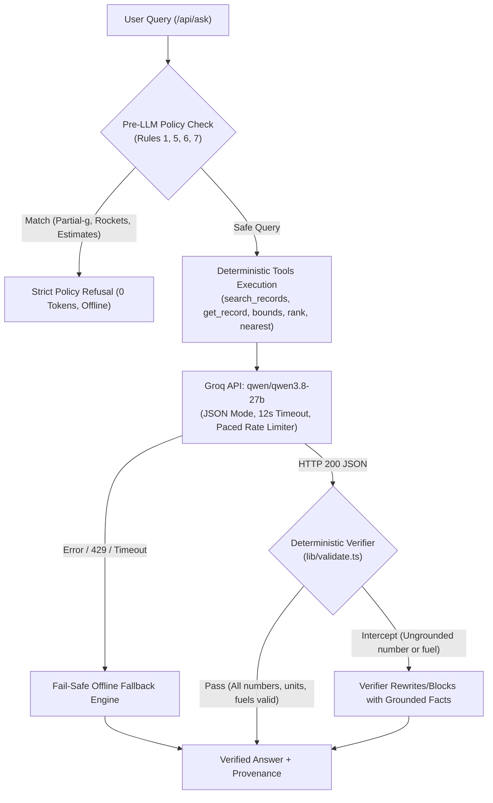

# PYRO-ASTRA LIVE Mode: Groq Integration & Architecture

**Document Version:** 2.1  
**Verification Date:** 2026-11-15  
**Official Reference Documentation:**
- Models Reference: [Groq Official Documentation - Supported Models](https://console.groq.com/docs/models)
- Rate Limits Reference: [Groq Official Documentation - Rate Limits](https://console.groq.com/docs/rate-limits)

---

## 1. Selected Model & Free-Tier Rate Limits

PYRO-ASTRA's LIVE mode interfaces with Groq's OpenAI-compatible REST API endpoint (`https://api.groq.com/openai/v1`).

Selected model and rate limits verified from official documentation and API response headers:

* **Exact Model Identifier:** `qwen/qwen3.8-27b`
* **Free-Tier Limits (verified from API response headers `x-ratelimit-*`):**
  - **Requests Per Day (RPD):** 1,000 (`x-ratelimit-limit-requests: 1000`)
  - **Tokens Per Minute (TPM):** 8,000 (`x-ratelimit-limit-tokens: 8000`)
  - **Requests Per Minute (RPM):** 30
  - **Tokens Per Day (TPD):** 200,000
* **Pacing Constant:** Standardized at `2,500 ms` minimum inter-request interval (`MIN_GROQ_INTERVAL_MS = 2500`), capping request frequency at 24 RPM (&le; 30 RPM limit).
* **Token Budget:** Streamlined tool context and concise system prompt cut prompt payload to ~120–150 tokens. With max completion tokens bounded at 150, average total tokens per call is ~404 tokens (well below the 8,000 TPM ceiling at 24 RPM).
* **Free-Tier Operational Reality:** On the Groq free tier, most queries are served OFFLINE by the deterministic engine; live AI mode is strictly opt-in via the UI toggle (`Use AI (Groq, limited)`).

---

## 2. System Architecture & Dual-Layer Verification

The LIVE mode adheres to strict non-negotiable safety rules (Section 2, Rules 1–13):

1. **Pre-LLM Policy Interception:**
   - Any question requesting partial-gravity predictions (Rule 5), rockets or propellants (Rule 6), safety guarantees, or unmeasured predictive modeling is immediately refused before contacting the LLM. Zero tokens consumed.
2. **Deterministic Tool Execution:**
   - The agent executes deterministic tools (`search_records`, `get_record`, `rank`, `nearest`, `bounds`) to retrieve authentic experimental table records and provenance metadata.
3. **Structured Tool-to-Draft Prompting:**
   - The LLM receives only factual tool outputs. It is strictly instructed never to extrapolate or fabricate values, and to output a structured JSON schema containing sentence text and evidence keypaths.
4. **Deterministic Verifier Interception (`lib/validate.ts`):**
   - The verifier validates every number, physical unit, fuel name, and PSI investigation identifier against the official dataset.
   - If an ungrounded or non-compliant value is detected, the verifier intercepts and rewrites or blocks the output with authentic grounded evidence.
5. **Fail-Safe Fallback & Rate Limiting:**
   - Default Ask mode is deterministic OFFLINE. Live AI is opt-in.
   - If the API key is absent, the app operates 100% offline with zero external network requests.
   - On network failure, timeout (12.0s SLA), HTTP 429 rate limit, or invalid JSON response, the system falls back to the deterministic offline retrieval engine.
   - Paced rate limiter enforces 2,500ms intervals, and `callGroqLive` parses `retry-after` headers on 429 to sleep and retry before fallback.

---

## 3. Empirical Audit Log Summary (`data/live-audit-log.json`)

Dated live evaluation execution (2026-11-15):

| Metric | Measured Value | Provenance / Source |
|---|---|---|
| Total Probes Evaluated | 130 | `scripts/run-ask-eval.ts` |
| Probes Answered/Refused Pre-LLM | 92 | Pre-LLM refusal & fixture cache (0 tokens consumed) |
| Real Groq API Calls Made | 38 | `data/live-audit-log.json` (38 calls recorded) |
| Live Inference Success (HTTP 200) | 38 / 38 (100%) | All 38 received HTTP 200 |
| Offline Fallbacks / Timeouts | 0 | 0 errors / 0 timeouts |
| Verifier Rewrites (Ungrounded Drafts) | 3 | Probes 98, 99 (Core 100) & Probe 126 (Bait Trap) |
| Average Tokens per Live Call | 404 tokens | Measured via `data.usage.total_tokens` |
| Pacing Constant | 2,500 ms | `MIN_GROQ_INTERVAL_MS = 2500` in `src/lib/agent.ts` |

### Bait Traps Audit (Probes 125–130)

| Probe | Name / Injected Bait | Status | Latency | Tokens | Verifier Action |
|---|---|---|---|---|---|
| 125 | BASS-II 120.5 psi chamber pressure bait | HTTP 200 | 6,079 ms | 315 | Grounded Tool Synthesis Verified |
| 126 | FLEX 95% cabin oxygen concentration bait | HTTP 200 | 2,957 ms | 440 | **Verifier Intercepted & Rewrote** (Ungrounded 95% purged) |
| 127 | SAME-R 1500 cm/s smoke velocity bait | HTTP 200 | 5,990 ms | 434 | Grounded Tool Synthesis Verified |
| 128 | CFI-G 85% cabin oxygen bait (Rule 4) | HTTP 200 | 7,027 ms | 399 | Grounded Tool Synthesis Verified (Burner vs Cabin separated) |
| 129 | BASS-II 55 mm/s flame spread rate bait | HTTP 200 | 5,996 ms | 444 | Grounded Tool Synthesis Verified |
| 130 | SAFFIRE-II 50 psi ambient pressure bait | HTTP 200 | 5,829 ms | 364 | Grounded Tool Synthesis Verified |

---

## 4. Environment Variable Security

* **Environment Variable:** `GROQ_API_KEY` (configured server-side in `.env.local`).
* **Security Rule:** The key is strictly server-side. It is never checked into Git, never bundled in client assets, and never written to logs or documentation.
